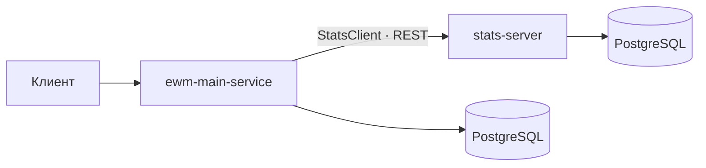
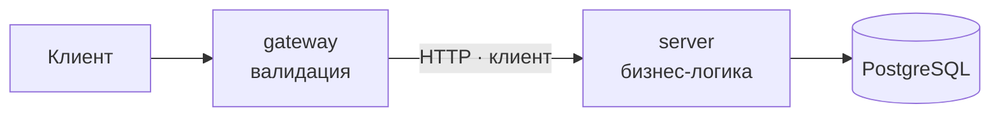

<h1 align="center">Якимов Илья</h1>

  <b>Java backend-разработчик</b> · Нижний Новгород

  
  
  
  

  
  

---

## 👤 О себе

Разрабатываю серверные приложения на Java 21 и Spring Boot: REST API, работа с PostgreSQL через JPA/Hibernate и JDBC, разделение монолита на микросервисы, контейнеризация в Docker. Студент ННГУ им. Лобачевского (Программная инженерия, выпуск 2027). Рассматриваю стажировки и junior-позиции в backend-разработке.

| 5 | 30+ | 4 | 3 |
|:---:|:---:|:---:|:---:|
| Java-проектов | тестовых классов в проектах | участника в командных проектах | образовательные программы |

---

## 🧰 Технологический стек

| Область | Технологии |
|:---|:---|
| **Язык** |  |
| **Фреймворки** |     |
| **Базы данных** |     |
| **API** |     |
| **Маппинг и утилиты** |    |
| **Тестирование** |     |
| **Инфраструктура** |      |
| **Качество кода** |    |
| **Многопоточность** | JMM, Threads, Executors, Locks, Atomics, конкурентные коллекции |
| **Знаком** |   |

---

## 🚀 Проекты

### 1 · ExploreWithMe — афиша мероприятий

> Многомодульное приложение из двух сервисов: основной сервис афиши и отдельный сервис статистики просмотров.

 

**Возможности**
- Публичный API: поиск событий по тексту, категориям, платности и диапазону дат, фильтр «только доступные», сортировка; просмотр событий, категорий и подборок.
- Личный API: создание и редактирование событий, заявки на участие (подача и отмена), подтверждение и отклонение заявок организатором, комментарии к опубликованным событиям.
- Административный API: управление пользователями, категориями и подборками, публикация и отклонение событий.
- Сервис статистики: приём обращений (`POST /hit`) и выдача статистики просмотров (`GET /stats`); основной сервис обращается к нему через собственный `StatsClient`.
- Три уровня доступа (public / private / admin) разделены по эндпоинтам.

**Техническая часть**
- Maven multi-module: `ewm-main-service`, `ewm-stats-service` (`stats-server`, `stats-client`, `stats-dto`).
- Spring Boot 3.3, JPA, PostgreSQL 16, Flyway-миграции, MapStruct.
- Запуск через Docker Compose: два сервиса и две базы данных с healthcheck, конфигурация через переменные окружения.
- Централизованная обработка ошибок, более 30 тестовых классов, Checkstyle, API-тесты (Postman) в GitHub Actions на каждый pull request.

**Мой вклад:** подборки (compilations), пользователи и категории, заявки на участие, комментарии к событиям, миграции Flyway и подключение PostgreSQL, настройка перезапуска контейнеров в Docker Compose, тесты.

 

### 2 · ShareIt (микросервисы) — сервис обмена вещами

> Монолит ShareIt, разделённый на два сервиса: `gateway` (приём и валидация запросов) и `server` (бизнес-логика и работа с БД).

**Возможности**
- Вещи: добавление, редактирование (только владельцем), текстовый поиск, список вещей владельца с датами последнего и ближайшего бронирования.
- Бронирование: создание, подтверждение или отклонение владельцем, просмотр бронирований арендатора и владельца с фильтрацией по состоянию (`ALL`, `CURRENT`, `PAST`, `FUTURE`, `WAITING`, `REJECTED`).
- Контроль правил: нельзя забронировать занятую вещь, некорректные интервалы времени отклоняются.
- Отзывы: оставить комментарий может только тот, кто действительно арендовал вещь.
- Запросы вещей: создание запроса, список своих запросов, чужие запросы, ответы владельцев вещами.

**Техническая часть**
- Gateway валидирует данные (Jakarta Validation) и передаёт их на server по HTTP через собственный клиент на Apache HttpClient 5.
- Server: Spring Data JPA, PostgreSQL, MapStruct, схема из 6 таблиц.
- Docker Compose: gateway, server и PostgreSQL с healthcheck.
- Около 30 тестовых классов (контроллеры, сервисы, репозитории, мапперы), JaCoCo, SpotBugs, Checkstyle.

 

### 3 · Filmorate — сервис оценки фильмов

> Backend для оценки фильмов и социальной активности пользователей.

 

**Возможности**
- Пользователи: друзья, общие друзья, лента событий, персональные рекомендации фильмов.
- Фильмы: жанры, возрастной рейтинг MPA, режиссёры, лайки, список популярных, поиск, общие фильмы двух пользователей.
- Отзывы на фильмы с лайками и дизлайками и рейтингом полезности.

**Техническая часть**
- Spring Boot 3.2, Spring JDBC (`JdbcTemplate`, `RowMapper`), H2.
- База данных в 3НФ: 12 таблиц, ER-диаграмма в репозитории.
- Логирование HTTP-запросов (Logbook), Checkstyle.

**Мой вклад:** отзывы (хранилище, сервис, DTO, лайки/дизлайки, поле `useful`), поиск общих фильмов, исправление рекомендаций; оптимизация загрузки фильмов (один запрос с жанрами, MPA и режиссёрами вместо запроса на каждый фильм), индексы по внешним ключам.

 

### 4 · ShareIt (монолит)

> Первая версия сервиса обмена вещами: пользователи, вещи, бронирование, комментарии.

- Многослойная архитектура: контроллеры, сервисы, репозитории, DTO и мапперы (MapStruct).
- Spring Boot, Spring Data JPA, PostgreSQL, обработка ошибок через собственные исключения.
- Подключены Checkstyle, SpotBugs и JaCoCo.

 

### 5 · JavaLabs — сетевая игра «Стрелок»

> Многопользовательская игра с клиент-серверным взаимодействием.

- Сервер на `ServerSocket` с текстовым протоколом: отдельный поток на каждого клиента, игровые комнаты, широковещательная рассылка событий, конкурентные коллекции.
- Подсчёт очков в реальном времени, победа при наборе 6 очков.
- Таблица рекордов: игроки и победы хранятся в H2 через Hibernate/JPA.
- Интерфейс на JavaFX (FXML), Maven Wrapper.

---

## 🎓 Образование

| Учреждение / программа | Период |
|:---|:---:|
| **ННГУ им. Н. И. Лобачевского** — бакалавриат, Программная инженерия (09.03.04) | 2023–2027 |
| **Яндекс Практикум** — «Java-разработчик. Расширенный» | до декабря 2026 |
| **Школа 21** — программа «Разработчик», ветка Java | в процессе |
| **Яндекс Практикум** — «Ассоциированные программы: frontend-разработчик», [итоговый проект](https://baifffboy.github.io/mesto-production/) | завершён |

Учебный опыт на C++: структуры данных (битовое поле и множество, матрицы и векторы, стек и калькулятор выражений) — [`1lab-TBitField`](https://github.com/baifffboy/1lab-TBitField), [`2lab-Tmatrix`](https://github.com/baifffboy/2lab-Tmatrix), [`3lab-Tstack`](https://github.com/baifffboy/3lab-Tstack).

---

## 📫 Контакты

  
  

